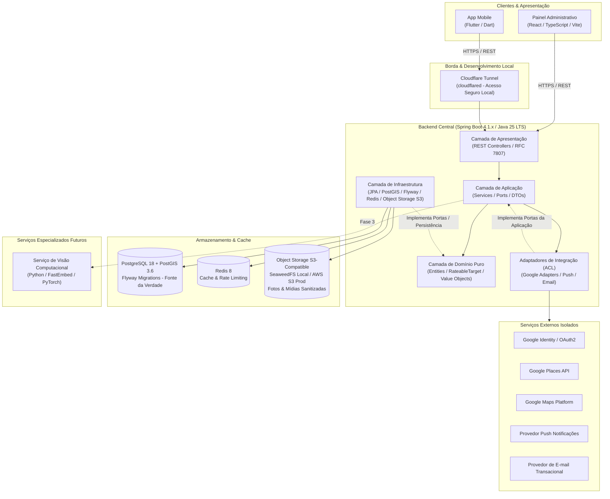
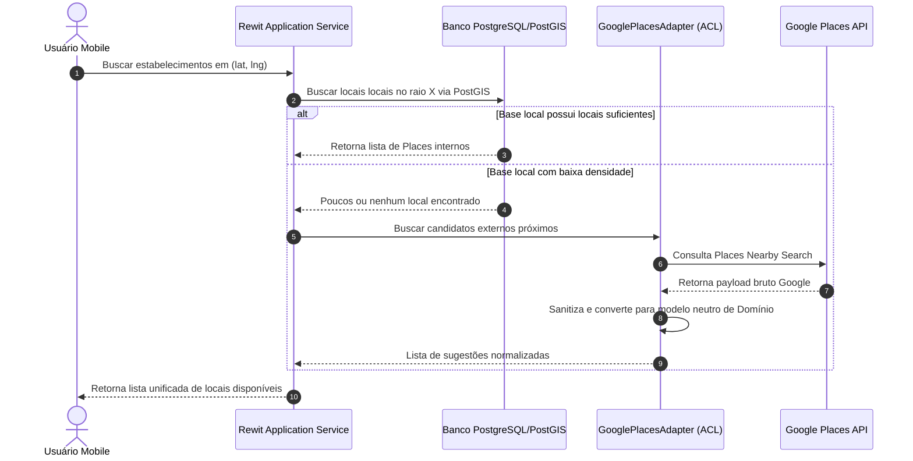

# REWIT - ARQUITETURA DE SOFTWARE (ARCHITECTURE.md)

---

## 1. Visão Geral do Sistema

O **Rewit** é construído sob uma arquitetura modular moderna orientada a serviços desacoplados e baseada nos princípios de **Clean Architecture (Hexagonal / Portas e Adaptadores)**.

A plataforma suporta múltiplos clientes (aplicativo mobile multiplataforma e painel administrativo web) consumindo uma API RESTful central de alta performance construída em Java / Spring Boot, com persistência relacional e espacial no PostgreSQL/PostGIS, cache de sessão e feeds em Redis, e armazenamento de objetos S3-compatible (SeaweedFS 4.47 em ambiente local, AWS S3 / Cloudflare R2 em produção).



---

## 2. Estrutura do Repositório (Modular Monorepo)

O projeto é organizado no padrão de repositório único modular (*Modular Monorepo*), mantendo todos os componentes do ecossistema sincronizados, versionados e com regras arquiteturais compartilhadas:

```
/
├── apps/
│   ├── mobile/                # Aplicação cliente Flutter (iOS / Android)
│   └── admin/                 # Painel administrativo web (React / TypeScript / Vite)
│
├── backend/                   # API REST Central (Java 25 LTS / Spring Boot 4.1.x)
│   ├── src/
│   │   ├── main/
│   │   │   ├── java/com/rewit/
│   │   │   │   ├── presentation/      # REST Controllers, DTOs de entrada/saída, validações
│   │   │   │   ├── application/       # Serviços, orquestração e portas (application/port)
│   │   │   │   ├── domain/            # Entidades puras (RateableTarget), enums, value objects
│   │   │   │   ├── infrastructure/    # Adaptadores JPA, PostGIS, integração (infrastructure/integration)
│   │   │   │   ├── config/            # Beans de configuração Spring (Security, Cache, OpenApi)
│   │   │   │   └── common/            # Respostas padronizadas, tratamento global de erros RFC 7807
│   │   │   └── resources/             # application.yml, migrations Flyway (db/migration)
│   │   └── test/                      # Testes unitários, de invariantes e validação de schema
│   └── pom.xml                        # Gerenciamento de dependências Maven
│
├── services/
│   └── vision/                # Serviço futuro de inteligência visual e embeddings (Python)
│
├── infrastructure/
│   ├── docker/                # Dockerfiles de build de cada serviço
│   ├── cloudflare/            # Configurações do túnel local cloudflared
│   └── postgres/              # Scripts de inicialização do PostGIS e extensões
│
├── docs/                      # Documentação técnica viva e especificações
│   ├── architecture/          # Desenhos detalhados e fluxos
│   ├── domain/                # Modelagem detalhada das entidades
│   ├── database/              # Esquema relacional e índices espaciais
│   ├── api/                   # Contratos de rotas e especificações OpenAPI
│   ├── security/              # Políticas de privacidade, sanitização e LGPD
│   ├── integrations/          # Detalhamento de integrações externas
│   ├── development/           # Guias de setup e ambiente local
│   ├── deployment/            # Estratégia de CI/CD e ambientes
│   └── decisions/             # Architecture Decision Records (ADRs)
│
├── scripts/                   # Utilitários de automação de desenvolvimento
├── .env.example               # Matriz documentada de variáveis de ambiente
├── .gitignore                 # Filtro rigoroso de segurança e build
├── README.md                  # Ponto de entrada do desenvolvedor
├── PROJECT_RULES.md           # 31 regras mandatórias do projeto
├── PRODUCT_VISION.md          # Visão de negócio e produto
├── ARCHITECTURE.md            # Este documento
├── CONTRIBUTING.md            # Guia de contribuição e código
├── SECURITY.md                # Diretrizes de reporte de vulnerabilidades
├── CHANGELOG.md               # Registro histórico de alterações
└── docker-compose.yml         # Orquestração dos serviços de infraestrutura local
```

---

## 3. Arquitetura do Backend (Java / Spring Boot)

O backend do Rewit foi projetado para evitar o acoplamento excessivo que comumente degrada projetos legados. A estrutura é dividida em círculos concêntricos:

### Camadas e Responsabilidades:
1. **Domínio (`com.rewit.domain`)**:
   - É o núcleo do sistema.
   - Contém entidades ricas em comportamento de negócio (ex: invariantes de User e Profile, validação de nota entre 1.0 e 5.0, estados de avaliação, cálculo de média).
   - **Zero dependências** de Spring, JPA, Hibernate, PostgreSQL ou bibliotecas web.
2. **Aplicação (`com.rewit.application`)**:
   - Define as portas de saída (*Ports*) em `com.rewit.application.port` (ex: `UserRepository`, `ProfileRepository`).
   - Orquestra os fluxos de casos de uso (ex: `CreateReviewUseCase`, `VerifyCheckInUseCase`).
   - Coleta dados das portas e despacha eventos.
   - Gerencia transações declarativas na fronteira de serviço (`@Transactional`).
3. **Apresentação (`com.rewit.presentation`)**:
   - Expõe endpoints HTTP RESTful versionados (`/api/v1/...`).
   - Valida payloads com Jakarta Bean Validation (`@Valid`, `@NotNull`, `@Min`, `@Max`).
   - Mapeia exceções de domínio para respostas de erro padronizadas [RFC 7807](https://tools.ietf.org/html/rfc7807) via `@ControllerAdvice`.
4. **Infraestrutura (`com.rewit.infrastructure`)**:
   - Implementa as portas de persistência via adaptadores em `com.rewit.infrastructure.persistence.adapter` (`UserRepositoryAdapter`, `ProfileRepositoryAdapter`).
   - Mapeia tabelas relacionais em entidades JPA isoladas (`UserJpaEntity`, `ProfileJpaEntity`) sem expô-las ao domínio.
   - Consulta PostgreSQL 18 via Spring Data JPA (`UserJpaRepository`, `ProfileJpaRepository`).
   - Detalhes completos da estratégia em [docs/architecture/persistence.md](file:///docs/architecture/persistence.md) e da arquitetura de autenticação local/sessões em [docs/architecture/authentication.md](file:///docs/architecture/authentication.md).
   - Gerencia conexões e operações de cache com Redis via `RedisTemplate`.
   - Gerencia autenticação stateless via Spring Security 7.x, tokens JWT (HS256) e sessões revogáveis persistidas em `auth_sessions`.
   - Gerencia upload e recuperação de mídias via abstração de Object Storage S3-compatible desacoplada (SeaweedFS 4.47 em desenvolvimento local, AWS S3 / Cloudflare R2 em produção).
5. **Integrações (`com.rewit.integrations`)**:
   - Camada Anti-Corrupção (ACL) para serviços externos.
   - Subpacotes isolados:
     - `integrations/google/identity`: Validação de tokens JWT do Google OAuth2;
     - `integrations/google/places`: Busca de locais para enriquecimento inicial;
     - `integrations/google/maps`: Geração de links e cálculos auxiliares;
     - `integrations/google/reviews`: Geração de URLs para avaliação oficial;
     - `integrations/notification`: Implementações agnósticas de push e e-mail.

### Invariantes Centrais de Integridade e Domínio (Step 2.1):
- **Obrigatoriedade de Alvo na Review**: Uma `Review` não é uma postagem genérica. Ela atua como Raiz de Agregado e deve obrigatoriamente possuir pelo menos um `ReviewTarget` com nota avaliada entre 1.0 e 5.0 estrelas. O texto da experiência é opcional, mas a avaliação em estrelas é mandatória.
- **Ciclo de Vida do CheckIn**: Todo novo `CheckIn` inicia com status `PENDING` por padrão (nunca `VERIFIED`). A transição para `VERIFIED` depende de validação real de presença física.
- **Data de Verificação (`verified_at`)**: Permanece estritamente `null` enquanto o `CheckIn` estiver `PENDING` ou for `REJECTED`. É preenchida exclusivamente no instante real em que o check-in passa efetivamente para `VERIFIED` via transição de domínio explícita (`verify`).
- **Fonte da Verdade para "Verified on Site"**: O status `CheckIn.status == VERIFIED` é a **única fonte da verdade**. A propriedade `Review.isVerifiedOnSite` é estritamente uma projeção/cache desnormalizado de leitura, sincronizada automaticamente e protegida contra alterações avulsas arbitrárias por validações de domínio e triggers de banco.
- **Inseparabilidade CheckIn ↔ Review**: O `CheckIn` é indissociável da sua `Review`. As invariantes `check_in.review_id = review.id`, `check_in.user_id = review.user_id` e `check_in.place_id = review.context_place_id` são garantidas a nível de schema e triggers. Quando o `context_place_id` da `Review` for `NULL`, nenhum `CheckIn` é admitido.
- **Validação de Presença (Check-in V1)**: Decidida só no backend, na transação de criação da `Review`, por `PresenceVerificationPolicy`: distância pelo PostGIS dentro do raio do local (teto de 250 m, também CHECK `chk_places_validation_radius_max` desde a V41), precisão horizontal do GPS de até 100 m e no máximo um `VERIFIED` por usuário e local em 24 horas móveis. A regra de frequência consulta a janela depois de um `pg_advisory_xact_lock` por usuário e local (liberado no commit ou rollback), apoiada no índice parcial `idx_checkins_verified_user_place`. Recusas com medição ficam `REJECTED`; a resposta da criação informa o resultado (`checkIn.status`/`reason`) sem coordenadas nem distância.
- **Coerência da Raiz RateableTarget**: O `RateableTarget` atua como raiz física relacional (ADR-009). Triggers do banco e o modelo de domínio garantem coerência bidirecional estrita entre `rateable_targets.target_type` e a respectiva tabela especializada (`places`, `products`, `services`, `events`), impedindo alvos vinculados à tabela errada ou mutação de tipo pós-vínculo.

---

## 4. Estratégia de Isolamento do Google (Anti-Corruption Layer)

O Google não é a fonte primária de dados do Rewit. As integrações com APIs do Google seguem um padrão estrito de adaptador:



- **Invariante**: Nenhuma classe de domínio conhece o formato JSON de resposta do Google Places. O adapter converte o payload em tipos primitivos do Rewit antes de repassar para os serviços da aplicação.
- **Armazenamento de Place ID**: O identificador externo `google_place_id` é gravado apenas como um campo de metadado de enriquecimento na tabela `places` para correlacionamento futuro.

---

## 5. Banco de Dados e Modelagem Espacial (PostgreSQL + PostGIS)

### Justificativa Técnica:
O PostgreSQL com a extensão PostGIS é a tecnologia padrão ouro global para bancos de dados espaciais corporativos. Oferece alta precisão esferoidal no elipsoide WGS 84 (`SRID 4326`), suporte nativo a índices GiST R-Tree de altíssima velocidade e funções geodésicas completas.

### Convenções de Modelagem Espacial:
- Todas as coordenadas geográficas são armazenadas utilizando o tipo `GEOGRAPHY(Point, 4326)`. O tipo `geography` calcula distâncias automaticamente em metros geodésicos sobre a curvatura da Terra, evitando as distorções do tipo geométrico cartesiano planar.
- Criação mandatória de índices GiST sobre colunas espaciais:
  ```sql
  CREATE INDEX idx_places_coordinates ON places USING GIST (coordinates);
  CREATE INDEX idx_checkins_coordinates ON check_ins USING GIST (coordinates);
  ```
- **Consulta de Proximidade (Exemplo de Consulta PostGIS)**:
  ```sql
  SELECT p.*, ST_Distance(p.coordinates, ST_SetSRID(ST_MakePoint(:userLng, :userLat), 4326)::geography) AS distance_meters
  FROM places p
  WHERE ST_DWithin(p.coordinates, ST_SetSRID(ST_MakePoint(:userLng, :userLat), 4326)::geography, :radiusMeters)
  ORDER BY distance_meters ASC;
  ```

---

## 6. Camada de Cache e Armazenamento

### Redis 8:
- **Cache de Leitura**: Armazenamento de feeds calculados, listas de categorias e dados quentes de locais populares com TTL (Time-To-Live) configurado.
- **Rate Limiting**: Proteção de endpoints sensíveis (autenticação, criação de avaliações, scanner) contra abuso e ataques DoS.
- **Sessões e Tokens Efêmeros**: Invalidação de sessões de usuário e armazenamento temporário de desafios de verificação.

### MinIO (S3-Compatible Object Storage):
- Utilizado em ambiente de desenvolvimento local simulando buckets S3 da AWS.
- Armazena imagens de avatares, fotos de publicações, capas de locais e evidências de produtos.
- **Sanitização Prévia**: Todas as imagens enviadas ao bucket passam obrigatoriamente por pipeline de remoção de metadados EXIF/GPS para salvaguardar a privacidade física dos usuários.

---

## 7. Acesso Seguro Local e Desenvolvimento (Cloudflare Tunnel)

Para viabilizar o teste local em dispositivos móveis físicos conectados na rede móvel (4G/5G) e o recebimento de webhooks sem necessidade de IP público estático ou redirecionamento perigoso de portas no roteador doméstico, a arquitetura prevê a integração com o **Cloudflare Tunnel (`cloudflared`)**:
- O túnel cria uma ponte criptografada de saída entre o container local e a rede global da Cloudflare.
- Nenhum firewall precisa ser aberto na máquina de desenvolvimento.
- O token é completamente externalizado no arquivo `.env` sob a variável `CLOUDFLARE_TUNNEL_TOKEN`.

---

## 8. Abstração de Notificações e Comunicações

Para prevenir vendor lock-in e manter o princípio de independência:
- **Push Notifications**: Definida a interface `PushNotificationService`. Em ambiente local de desenvolvimento, utiliza uma implementação mock/log (`LoggingPushNotificationService`). Em produção, adaptadores especializados podem despachar via FCM, OneSignal ou APNs.
- **E-mails Transacionais**: Definida a interface `EmailNotificationService`. Em ambiente local, imprime o e-mail no console ou utiliza um servidor SMTP mock (ex: MailHog).
- **Proibição**: O Firebase **não** é o banco de dados principal, não é o backend e não é o motor primário da aplicação.

---

## 9. Arquitetura do Cliente Mobile (Flutter / Android / iOS)

O aplicativo cliente móvel (`apps/mobile`) é desenvolvido em **Flutter** (Dart 3.13+ / Flutter 3.47+) com arquitetura modular desacoplada e foco em confiabilidade offline/resiliente e performance visual.

### 9.1 Estrutura em Camadas e Organização por Features
Cada funcionalidade de negócio do app é isolada em um módulo auto-contido sob `lib/features/<nome_da_feature>/`:
* **`domain/`**: Entidades puras imutáveis, value objects, contratos de repositórios (`FeedRepository`, `ReportRepository`, `DiscussionRepository`, etc.) e serviços de hardware (`LocationService`, `CameraPermissionService`);
* **`data/`**: Implementações de repositório, clientes HTTP REST (consumindo RFC 7807 e distinguindo códigos de sucesso semânticos como `201 Created` vs `200 OK` em `ReportRepositoryImpl`), persistência segura local via `FlutterSecureStorage` e adaptadores de sensores nativos;
* **`presentation/`**: Gerenciamento de estado reativo via `ChangeNotifier` / `StateNotifier` (`FeedNotifier`, `ScannerNotifier`, `AuthNotifier`), telas (`HomeScreen`, `ReviewCreateScreen`, `ReviewDetailScreen`, `ScannerScreen`, `CheckInScreen`, `SearchScreen`, `RankingsScreen`, `CollectionScreen`) e widgets especializados (como `ReportReviewDialog` em `features/reports/`);
* **`app/`**: Roteador central tipado (`AppRouter`), Design System e tokens visuais (`AppTheme`, `RewitTokens`, `RewitSemanticColors`, `ThemeController`).

### 9.2 Navegação e Home V2
A tela inicial autenticada (`HomeScreen`) adota o padrão de navegação com barra inferior (`NavigationBar`) indexada contendo 5 destinos canônicos:
1. **Início (0)**: `FeedView` com abas dual ("Para você" e "Seguindo");
2. **Explorar (1)**: `SearchScreen(embedded: true)` com busca textual e cadastro de novos locais;
3. **Rankings (2)**: `RankingsScreen(embedded: true)` com ordenação regional por notas e dimensões;
4. **Check-in (3)**: `CheckInScreen(embedded: true)` com busca por proximidade e histórico;
5. **Coleção (4)**: `CollectionScreen(embedded: true)` com estado vazio honesto até implementação do backend de coleções.

* **Navegação Defensiva com PopScope**: O toque no botão de retorno fora da aba Início transiciona o índice da Home de volta para Início (`_currentIndex = 0`), prevenindo saída acidental da aplicação.
* **Ações Rápidas (FAB)**: O botão flutuante central disponibiliza folha de ação para iniciar "Nova Avaliação" (`/review/create`) ou "Fazer Check-in".

### 9.3 Gerenciamento de Estado do Feed Duplo
O `FeedNotifier` gerencia o estado da timeline com dois canais completamente isolados:
* **Canal `FeedType.forYou`**: Consome `/api/v2/feed` (recomendações com diversificação e afinidade);
* **Canal `FeedType.following`**: Consome `/api/v1/feed` (ordenação cronológica estrita de seguidos);
* **Isolamento de Estado**: Cada canal possui controle independente de itens, página atual, estado de loading e scroll;
* **Rollback Granular**: Reações de voto útil (`helpful`) aplicam mutação otimista com reversão imediata caso ocorra erro na chamada HTTP;
* **Preservação de Removidos**: Durante recovery reloads, IDs de avaliações excluídas ou ocultadas são preservados para evitar o reaparecimento de itens obsoletos.

### 9.4 Scanner e Target Selection Mode
O subsistema de leitura óptica (`features/scanner/`) opera em dois modos:
* **Modo Normal**: Navegação autônoma em `/scanner` para leitura de códigos de barras (EAN-13, EAN-8, UPC-A, ITF-14) ou QR Codes com consulta de catálogo;
* **Target Selection Mode (`ScannerRouteArgs(selectionMode: true)`)**: Invocado pelo formulário de criação de avaliações (`ReviewCreateScreen` / `TargetSearchSelectorWidget`). Ao detectar e confirmar um produto ou local, retorna o identificador selecionado diretamente para preenchimento automático do formulário de avaliação;
* **Explicação Pré-Permissão e Legibilidade**: Antes da primeira solicitação nativa de câmera, exibe o estado `ScannerPermissionRationale` com justificativa clara de uso (`Continuar` / `Agora não`) sem disparar prompt prematuro nem repetir em loop após recusa prévia; a `AppBar` fixa ícones e título em `RewitSemanticColors.onMediaScrim` sobre `mediaScrim` para garantir contraste sobre o preview da câmera tanto no tema claro quanto no escuro;
* **Ciclo de Vida Resiliente e Controle de Flash**: O controller óptico (`MobileScannerController`) interrompe a câmera em eventos de pausa (`AppLifecycleState.paused` / `inactive`) e reativa de forma limpa em `resumed`. O estado da lanterna/flash na interface é dirigido exclusivamente por `MobileScannerState.torchState` (`unavailable`, `off`, `on`, `auto`), desabilitando o controle sem estado local obsoleto em câmeras sem hardware de flash, trocas de câmera, erros ou descarte do controller.

### 9.5 Máquina de Estados Nativa de Permissão de Câmera (Android API 36)
Para compatibilidade estrita com Android API 36 (onde diálogos cancelados ou recusados pela primeira vez poderiam reportar incorretamente `shouldShowRequestPermissionRationale == false`), foi implementada uma máquina de estados pura em Kotlin:
* **Componente Nativo**: `app.rewit.mobile.CameraPermissionStateMachine` e `MainActivity.kt`;
* **Persistência**: Armazenamento do histórico real em `SharedPreferences` (`hasRequestedBefore`, `permanentlyDenied`), consultável sem efeitos colaterais via `hasRequestedPermissionBefore`;
* **Canal de Plataforma**: `MethodChannel('app.rewit.mobile/camera_permission')` consumido por `AndroidCameraPermissionService`;
* **Resolução**: Classifica deterministicamente entre `granted`, `denied` (permitindo novas tentativas via aplicativo) e `permanentlyDenied` (acionando botão para abrir configurações do sistema).

### 9.6 Política de Localização (Descoberta vs Verificação Presencial)
A captura de coordenadas GPS no dispositivo é regida por `LocationCapturePolicy`:
* **Descoberta Externa (`discovery`)**: Busca estabelecimentos em raio de até 10 km. Permite leitura em cache de até 5 minutos e tentativa primária leve (`LocationAccuracy.medium`, timeout de até 5s); sem cache válido e mediante falha ou timeout da captura leve, aciona no máximo um fallback controlado (`LocationAccuracy.high`, até 4s adicionais dentro de teto total de 9s);
* **Verificação de Presença (`presenceVerification`)**: Utilizada exclusivamente para validar check-in presencial em avaliações. Rejeita cache antigo, exige leitura fresca (idade <= 1 minuto), alta precisão GPS, timeout ampliado (10s a 15s) para aquecimento de satélites e retry único caso a acurácia retorne superior a 100 metros;
* **Suporte a QA**: O aplicativo não bloqueia coordenadas simuladas no client, assegurando a realização de testes ponta a ponta e auditorias em emuladores;
* **Autoridade do Backend**: A emissão do selo `isVerifiedOnSite` é 100% calculada no backend via PostGIS (`ST_DWithin`, teto de 250m de raio, acurácia horizontal <= 100m, trava transacional `pg_advisory_xact_lock` e teto de 1 check-in por usuário/local a cada 24h).

### 9.7 Transporte HTTP e Decodificação UTF-8
* `RewitHttpClient` normaliza cabeçalhos `Content-Type` JSON/textuais sem `charset` para UTF-8 e `ProblemDetail.fromResponseBytes` decodifica bytes HTTP como UTF-8 por padrão, evitando corrupção de acentuação em respostas `application/problem+json` ou `application/json` que omitam `; charset=utf-8`, respeitando charsets explícitos e bytes corrompidos com `allowMalformed: true`.
