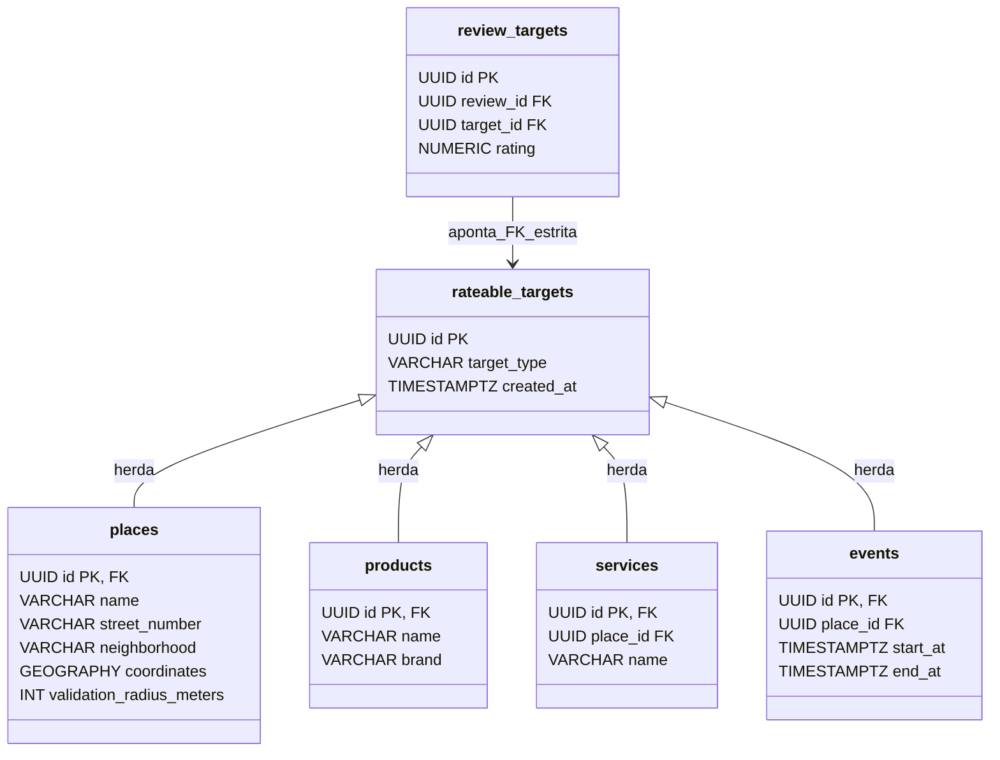

# ESQUEMA DE BANCO DE DADOS E POSTGIS (docs/database/schema-overview.md)

Este documento descreve a modelagem física relacional, a extensão espacial PostGIS e a estratégia de migrações determinísticas gerenciadas pelo **Flyway** na plataforma **Rewit**.

---

## 1. Tecnologias e Configurações Essenciais

- **SGBD**: PostgreSQL 18.x
- **Extensão Geoespacial**: PostGIS 3.6.x
- **Imagem Oficial Homologada**: `postgis/postgis:18-3.6`
- **Volume de Dados**: `postgres_data:/var/lib/postgresql` (padrão oficial PostgreSQL 18)
- **Sistema de Coordenadas (SRID)**: `4326` (WGS 84 - Elipsoide geodésico universal)
- **Tipo de Dado Espacial Padrão**: `GEOGRAPHY(Point, 4326)`
- **Estratégia de Versionamento**: **Flyway 11.x** (todas as alterações de banco são arquivos `.sql` imutáveis versionados em `backend/src/main/resources/db/migration`)
- **Validação no Hibernate**: `spring.jpa.hibernate.ddl-auto: validate` na aplicação (proibido `update` ou `create`). O perfil de testes não aplica essa validação a todos os contextos; o contrato entre entidades JPA e o schema Flyway é verificado por `JpaSchemaValidationIntegrationTest`, que sobe o contexto com `validate` e o mesmo dialeto PostGIS da aplicação. Colunas `NUMERIC` são mapeadas como `BigDecimal` com `precision`/`scale` correspondentes.
- **Migrations não transacionais**: uma migration com `CREATE INDEX CONCURRENTLY` (como a V16) precisa de um `.sql.conf` com `executeInTransaction=false` e de `spring.flyway.postgresql.transactional-lock=false`. Com o lock transacional padrão, o Flyway segura `pg_try_advisory_xact_lock` em uma transação aberta numa conexão separada, e o `CONCURRENTLY` espera essa transação terminar, o que nunca acontece. Com `false`, o Flyway usa o advisory lock de sessão (`pg_try_advisory_lock`/`pg_advisory_unlock`); as demais migrations continuam rodando cada uma em sua própria transação. A propriedade está em `application-local.yml` (único perfil da aplicação) e no `application.yml` de testes; um novo perfil precisa repeti-la, e o lock de sessão exige que o Flyway não passe por pooler em modo transação.

---

## 2. Invariante de Integridade Polimórfica (ADR-009)

Para viabilizar que uma única publicação (`Review`) avalie alvos de tipos completamente distintos (`Place`, `Product`, `PlaceService`, `PlaceEvent`) sem fragilidade relacional ou órfãos, adotamos o padrão **Rateable Target Root**:



- A tabela `review_targets` aponta diretamente para `rateable_targets(id)` com chave estrangeira estrita e constraint `UNIQUE (review_id, target_id)`.
- A integridade relacional é 100% garantida no próprio motor do PostgreSQL.

---

## 3. Gestão Desacoplada de Médias e Estatísticas (`rateable_target_stats`)

Conforme a **Regra 35 do Projeto**, é proibido armazenar notas médias móveis como colunas mutáveis avulsas dentro das tabelas de cadastro (`places.average_rating`, `products.average_rating`).

A tabela `rateable_target_stats`:
```sql
CREATE TABLE rateable_target_stats (
    target_id UUID PRIMARY KEY REFERENCES rateable_targets(id) ON DELETE CASCADE,
    average_rating NUMERIC(3, 2) NOT NULL DEFAULT 0.00 CHECK (average_rating >= 0.00 AND average_rating <= 5.00),
    reviews_count INT NOT NULL DEFAULT 0 CHECK (reviews_count >= 0),
    last_calculated_at TIMESTAMP WITH TIME ZONE NOT NULL DEFAULT NOW()
);
```
Isso isola transações de alta frequência de escrita das consultas de leitura do catálogo.

---

## 4. Histórico de Migrações Flyway

### `V1__initial_schema.sql` (Fundação Inicial)
- Ativa extensões `postgis`, `uuid-ossp`, `pg_trgm`, `pgcrypto`.
- Cria as primeiras 22 tabelas do ecossistema, constraints primárias e índices GiST.

### `V2__domain_consolidation.sql` (Consolidação do Domínio - Prompt 02)
- `users`: Adição de `deleted_at TIMESTAMPTZ` para prontidão de soft-deletion.
- `places`: Adição de `street_number VARCHAR(32)` e `neighborhood VARCHAR(128)`.
- `places`: Índice composto `idx_places_city_neighborhood` para buscas de bairro.
- `check_ins`: Adição de `verification_method VARCHAR(32) DEFAULT 'GPS'` com constraint `chk_checkin_verification_method` (`GPS`, `QR_CODE`, `NFC`, `BEACON`).
- `user_interests`: Adição de `weight NUMERIC(3, 2) DEFAULT 1.00` com constraint `chk_user_interest_weight` (entre 0.00 e 1.00).
- `notifications`: Adição de `metadata_json JSONB`.
- `rateable_target_stats`: Índice `idx_rateable_target_stats_rating` em `average_rating DESC`.

### `V3__domain_integrity_refinement.sql` (Refinamento de Integridade e Consistência - Step 2.1)
- `check_ins`: Alteração de status default para `'PENDING'`; remoção de NOT NULL e remoção de default em `verified_at`.
- `check_ins`: Adição de `chk_checkin_status` (`PENDING`, `VERIFIED`, `REJECTED`) e `chk_checkin_verified_at_consistency` (exige `verified_at IS NOT NULL` se VERIFIED e `IS NULL` se PENDING/REJECTED).
- `reviews`: Constraint única composta `uq_reviews_id_user_context_place (id, user_id, context_place_id)`.
- `check_ins`: Foreign Key composta `fk_check_ins_review_user_place (review_id, user_id, place_id) REFERENCES reviews (id, user_id, context_place_id) ON DELETE CASCADE`.
- `check_ins`: Trigger `trg_check_in_review_consistency` garantindo que `context_place_id` da review seja preenchido e que `user_id` e `place_id` sejam estritamente idênticos aos da review.
- `check_ins` / `reviews`: Trigger `trg_sync_check_in_to_review_verified` sincronizando `reviews.is_verified_on_site` com base em `CheckIn.status == 'VERIFIED'` (única fonte de verdade).
- `reviews`: Trigger `trg_prevent_unverified_review_flag` bloqueando alteração manual de `is_verified_on_site = TRUE` sem um CheckIn VERIFIED correspondente.
- `rateable_targets`: Constraint `chk_rateable_target_type` (`PLACE`, `PRODUCT`, `SERVICE`, `EVENT`).
- Especializações (`places`, `products`, `services`, `events`): Triggers `trg_validate_*_specialization` impedindo associação com alvos de tipo incorreto.

### `V4__identity_integrity.sql` (Integridade de Identidade e Autenticação - Step 3)
- `users`: Substituição da constraint `uq_users_email` por índice único case-insensitive `uq_users_email_lower ON users (LOWER(email))`. O e-mail permanece reservado incondicionalmente mesmo após soft-delete (`deleted_at IS NOT NULL`) para prevenir sequestro de contas e impersonação no MVP.
- `users`: Substituição do índice não-único `idx_users_provider` pelo índice único parcial `uq_users_provider_user_id ON users (auth_provider, provider_user_id) WHERE provider_user_id IS NOT NULL`. Permite múltiplos usuários `LOCAL` com `provider_user_id = NULL` sem colisão e assegura unicidade para identidades remotas (`GOOGLE`, `APPLE`).
- `profiles`: Substituição da constraint `uq_profiles_handle` por índice único case-insensitive `uq_profiles_handle_lower ON profiles (LOWER(handle))`. Preserva o índice trigram GIN `idx_profiles_handle_trgm` para buscas textuais parciais.
- `rateable_targets`: Trigger `trg_prevent_rateable_target_type_change` impedindo alteração de `target_type` de alvos já especializados.
- **CHECK constraints adicionadas**: `chk_review_status`, `chk_review_visibility`, `chk_review_location_accuracy`, `chk_places_status`, `chk_products_status`, `chk_services_status`, `chk_events_status`, `chk_users_auth_provider`, `chk_business_verification_status`, `chk_business_plan_tier`, `chk_review_tags_source`.

### `V43__checkin_coordinate_minimization.sql` (Minimização e Proteção de Coordenadas GPS)
- `check_ins`: Remoção do índice espacial `idx_checkins_coordinates` (`DROP INDEX IF EXISTS`).
- `check_ins`: Remoção de `NOT NULL` em `coordinates` e `distance_to_centroid_meters`.
- `check_ins`: Adição da coluna anulável `rejection_reason VARCHAR(64)` com constraints `chk_checkin_rejection_reason` (`ACCURACY_UNAVAILABLE`, `ACCURACY_TOO_LOW`, `OUTSIDE_RADIUS`, `RECENT_CHECK_IN`), `chk_checkin_rejection_reason_consistency` (`status = 'REJECTED' OR rejection_reason IS NULL`), `chk_checkin_coordinates_null` (`coordinates IS NULL`) e `chk_checkin_distance_only_verified` (`status = 'VERIFIED' OR distance_to_centroid_meters IS NULL`).
- Backfill imediato sem `DELETE`: `coordinates = NULL` em todos os registros históricos (`VERIFIED`, `REJECTED` e `PENDING`) e `distance_to_centroid_meters = NULL` nos registros históricos não verificados (`REJECTED` e `PENDING`), preservando integralmente as linhas, `reviews.is_verified_on_site` e os valores originais de `reviews.updated_at` (restaurados na mesma transação após o disparo da trigger `trg_sync_check_in_to_review_verified`).
- Validação final de privilégios mínimos via `rewit_assert_runtime_privileges()`.

### `V44__auth_identity_and_session_immutability_guards.sql` (Hardening de Autenticação F1)
- `users`: `trg_guard_user_role_assignment` (`fn_guard_user_role_assignment()`) impede o runtime `rewit_app` de alterar `role`, `id`, `created_at`, `auth_provider`, de definir/alterar `provider_user_id` (exceto `NULL` em conta já `DELETED`, para o purge LGPD) e de tirar uma conta de `DELETED`.
- `auth_sessions`: `trg_guard_auth_session_integrity` (`BEFORE UPDATE`) impede alterar `id`, `user_id`, `token_hash`, `issued_at`, `expires_at`, `created_at` e desrevogar (`revoked_at`).
- `auth_sessions`: **`DELETE` revogado de `rewit_app` e de `PUBLIC`** (um trigger `BEFORE UPDATE` não impede `DELETE` + `INSERT`). Removido de `deletable` em `rewit_assert_runtime_privileges()`; o cascade `users -> auth_sessions` continua restrito ao owner (o runtime não tem `DELETE` em `users`).
- Funções `SECURITY DEFINER` restritas (owner da migração; `search_path = pg_catalog, public, pg_temp`; `EXECUTE` revogado de `PUBLIC` e concedido só a `rewit_app`):
  - `rewit_purge_expired_auth_sessions(p_now TIMESTAMPTZ, p_limit INT)`: lotes `FOR UPDATE SKIP LOCKED` (1 a 10000) de sessões com `expires_at < LEAST(p_now, clock_timestamp())` e `replaced_by_session_id IS NULL`.
  - `rewit_purge_deleted_user_auth_sessions(p_user_id UUID)`: remove as sessões somente se `users.account_status = 'DELETED'` e `deleted_at IS NOT NULL`; senão `insufficient_privilege`.
- `rewit_assert_runtime_privileges()`: preserva a V37 e acrescenta: sem `DELETE` em `auth_sessions`, trigger `trg_guard_auth_session_integrity` ativo, as duas funções presentes com owner administrado pela role de migração (nunca `rewit_app`), `SECURITY DEFINER`, `search_path` fixo, `EXECUTE` só para `rewit_app`, nenhuma outra função `SECURITY DEFINER`, sem memberships de `rewit_app`.
- A V44 existe só na branch não integrada e foi corrigida no próprio arquivo (nenhum banco persistente a aplicou); ver ADR-017 §6.

### `V45__moderation_privilege_separation_and_decision_guards.sql` (Hardening de Moderação e Auditoria F2 — ADR-018)
- **Inventário reconciliado de tabelas**: o schema de aplicação passa de 47 tabelas (V1–V44) para **49 tabelas de aplicação** com a criação das duas novas trilhas append-only:
  - `account_moderation_audit_logs` (`SUSPEND`, `REINSTATE`, `DELETE` em contas de usuário);
  - `place_claim_moderation_audit_logs` (`APPROVE_CLAIM`, `REJECT_CLAIM` em reivindicações de estabelecimentos).
  - Ambas seguem o padrão desacoplado da V37 (`BEFORE INSERT ... FOR KEY SHARE` em vez de FKs `ON DELETE CASCADE`/`RESTRICT` em `users`) e possuem triggers que impedem `UPDATE`, `DELETE` e `TRUNCATE`.
- **Separação de roles (`rewit_app` vs. `rewit_media` vs. `rewit_mod`)**: garante as roles `rewit_media` (ciclo de vida público/automático de mídias de locais, SEC-F2-03) e `rewit_mod` (6 módulos administrativos), ambas com `NOSUPERUSER NOCREATEDB NOCREATEROLE NOINHERIT NOREPLICATION NOBYPASSRLS`, sem ownership e sem `SET ROLE` cruzado entre as 3 roles. Revoga de `rewit_app` qualquer escrita nas 6 trilhas de auditoria (incluindo `place_media_moderation_audit_logs`), `UPDATE` em `place_media`, escrita em `place_media_reports` e escrita administrativa em denúncias e reivindicações; concede a `rewit_media` exclusivamente o conjunto mínimo para remoções públicas, denúncias/auto-quarentena, troca de capa e expurgo `purged_at` (> 24h) de `place_media`; concede a `rewit_mod` exclusivamente o conjunto mínimo para os 6 módulos administrativos (incluindo `SELECT` em `check_ins` e `rateable_targets` para triggers existentes, `UPDATE` por coluna em `place_media_reports`, e `DELETE` restrito às tabelas de invalidação comercial V28/V29).
- **Autenticidade criptográfica de payload (`authenticity_mac`)**: adiciona `authenticity_mac VARCHAR(128)` com `CHECK (authenticity_mac ~ '^aud1\$[A-Za-z0-9_-]{1,32}\$[0-9a-f]{64}$')` e `txid` / `decision_txid` nas 6 trilhas de auditoria, em `place_media_reports` e em `place_claim_requests`.
- **Guards de máquina de estados por role**: protege `users` (`fn_guard_user_role_assignment`), `places` (`trg_a_guard_places_governance`, executado antes dos triggers destrutivos V28/V29/V39 e bloqueando qualquer mutação por `rewit_media`), `business_accounts`, `place_media_reports`, `review_reports`, `discussion_reports`, `place_claim_requests`, `reviews`, `review_discussions`, `business_responses`, `place_media` (proteção de `removal_source`, anti-backdating de `removed_at`, prazo mínimo de 24h em `purged_at` e bloqueio de `UPDATE` por `rewit_app`) e `review_media`.
- **Integridade transacional bidirecional (`DEFERRABLE INITIALLY DEFERRED`)**: correlaciona por `txid_current()` cada transição administrativa (`rewit_mod`) nos 6 módulos e cada transição pública/automática de `place_media`/`place_media_reports` (`rewit_media`) com seu registro correspondente de auditoria; transição sem auditoria ou auditoria órfã sem transição real falha no `COMMIT`.
- **Funções `SECURITY DEFINER` restritas**:
  - `public.rewit_auto_resolve_removed_place_media_reports(p_media_id UUID, p_notes VARCHAR)` (`search_path = pg_catalog, public, pg_temp`, `EXECUTE` somente para `rewit_media`, revogado de `PUBLIC`, `rewit_app` e `rewit_mod`, validando `session_user`, `place_media.status = 'REMOVED'` e `removal_source` não administrativo) encerra apenas denúncias `PENDING` para `AUTO_RESOLVED` sem tocar decisões finais prévias.
  - `public.rewit_release_place_quarantine_entry(p_entry_id UUID)` (`search_path = pg_catalog, public, pg_temp`, `EXECUTE` somente para `rewit_media`, revogado de `PUBLIC`, `rewit_app` e `rewit_mod`) substitui `DELETE` direto em `storage_object_quarantine` para `rewit_media`, validando `session_user`, exigindo estado `CONFIRMED_ORPHAN` e namespace `places/`.
- **`rewit_assert_runtime_privileges()`**: atualizado para auditar `rewit_app`, `rewit_media`, `rewit_mod`, isolamento de `SET ROLE`, novas trilhas, guards, privilégio mínimo estrito em `storage_object_quarantine` (`rewit_media` com apenas `UPDATE (id)` e sem `DELETE` direto) e a matriz exata de `EXECUTE` das 4 funções `SECURITY DEFINER` autorizadas (`rewit_purge_expired_auth_sessions` e `rewit_purge_deleted_user_auth_sessions` para `rewit_app`; `rewit_auto_resolve_removed_place_media_reports` e `rewit_release_place_quarantine_entry` para `rewit_media`).

### `V46__storage_quarantine_integrity_and_grace_hardening.sql` (Hardening de Quarentena e Grace Period do Storage GC — SEC-F2-04 / SEC-F2-04-R1, ADR-018)
- **Invariantes, Defaults e Reinício Conservador de `storage_object_quarantine`**:
  - `status` DEFAULT `'OBSERVED'`, `first_observed_at` DEFAULT `clock_timestamp()`, `last_observed_at` DEFAULT `clock_timestamp()`, `confirmed_at` DEFAULT `NULL`.
  - **Reinício conservador no upgrade (SEC-F2-04-VULN-01)**: todas as entradas preexistentes (sejam `OBSERVED` ou `CONFIRMED_ORPHAN`) têm seu estado temporal reiniciado incondicionalmente com um único instante `v_reset_at := clock_timestamp()` do PostgreSQL (`status = 'OBSERVED'`, `confirmed_at = NULL`, `first_observed_at = v_reset_at`, `last_observed_at = v_reset_at`, e ajuste coerente de `last_modified_at` futuro), preservando `id`, `object_key`, constraints e índices.
- **Trigger `trg_guard_storage_quarantine_integrity` (`BEFORE INSERT OR UPDATE`)**:
  - `INSERT`: garante que chamadores de runtime comum criem novas entradas exclusivamente como `OBSERVED` com `confirmed_at = NULL`. Força `first_observed_at = clock_timestamp()` e `last_observed_at = clock_timestamp()`, neutralizando timestamps retroativos/futuros fornecidos manualmente.
  - `UPDATE`: impõe imutabilidade estrita de `id` para todas as roles (SEC-F2-04-VULN-02) e de `object_key` e `first_observed_at` para roles de runtime. Bloqueia qualquer alteração direta de `status` e `confirmed_at` por conexões de runtime comum.
- **Função `SECURITY DEFINER` de Confirmação de Órfão**:
  - `public.rewit_confirm_storage_quarantine_entry(p_entry_id UUID)` (`search_path = pg_catalog, public, pg_temp`, `EXECUTE` concedido exclusivamente a `rewit_app`, revogado de `PUBLIC`, `rewit_media` e `rewit_mod`).
  - Valida `session_user` (`rewit_app` ou owner).
  - Trava a linha com `FOR UPDATE`.
  - Exige estado anterior `OBSERVED` (retorno idempotente se já `CONFIRMED_ORPHAN` com timestamps consistentes).
  - Valida rigorosamente pelo relógio do banco que `first_observed_at <= clock_timestamp() - INTERVAL '24 hours'`.
  - Rejeita timestamps futuros ou inconsistentes (`first_observed_at > clock_timestamp()`).
  - Atualiza atomicamente `status = 'CONFIRMED_ORPHAN'` e `confirmed_at = clock_timestamp()`.
- **Autoridade Temporal no Expurgo (SEC-F2-04-ARCH-01)**:
  - Dentro da transação de expurgo, após adquirir os locks da entidade pai e da entrada de quarentena (`FOR UPDATE`), e imediatamente antes da exclusão física, a aplicação executa consulta autoritativa com `clock_timestamp()` do PostgreSQL (usando `SELECT` normal, sem nova função `SECURITY DEFINER`) em ambos os namespaces (`reviews/` sob `rewit_app` e `places/` sob `rewit_media`), validando `status = 'CONFIRMED_ORPHAN'`, `first_observed_at <= v_now - INTERVAL '24 hours'`, `confirmed_at IS NOT NULL`, `confirmed_at <= v_now` e `confirmed_at >= first_observed_at + INTERVAL '24 hours'`.
- **Privilégios Mínimos Estritos**:
  - `rewit_app`: revogado `UPDATE` geral na tabela e revogado `UPDATE(id)`. Concedido `SELECT`, `INSERT` nas colunas de observação (`id`, `object_key`, `status`, `first_observed_at`, `last_observed_at`, `last_modified_at`), `UPDATE` restrito a `(last_observed_at, last_modified_at)` (suficiente para upsert de reobservação e para `SELECT ... FOR UPDATE` no PostgreSQL 18), `DELETE` e `EXECUTE` em `rewit_confirm_storage_quarantine_entry`. Bloqueada qualquer escrita direta em `id`, `confirmed_at`, `status`, `first_observed_at` ou `object_key`.
  - `rewit_media`: mantém apenas `SELECT` e `UPDATE(id)` (indispensável ao `SELECT ... FOR UPDATE`), com toda escrita direta bloqueada por `trg_guard_storage_quarantine_media_writes` e `trg_guard_storage_quarantine_integrity`, e liberação exclusiva via `rewit_release_place_quarantine_entry(UUID)`.
- **`rewit_assert_runtime_privileges()`**: atualizado para auditar os novos privilégios de `rewit_app` em `storage_object_quarantine` (sem UPDATE geral nem escrita em `id`/colunas protegidas), a presença de `trg_guard_storage_quarantine_integrity` e a 5ª função `SECURITY DEFINER` autorizada (`rewit_confirm_storage_quarantine_entry`).

---

## 5. Constraints do Banco de Dados

| Tabela | Nome da Constraint | Tipo | Regra / Expressão |
| :--- | :--- | :--- | :--- |
| `rateable_targets` | `chk_rateable_target_type` | CHECK | `target_type IN ('PLACE', 'PRODUCT', 'SERVICE', 'EVENT')` |
| `review_targets` | `chk_rating_range` | CHECK | `rating >= 1.0 AND rating <= 5.0` |
| `review_targets` | `uq_review_target` | UNIQUE | `(review_id, target_id)` |
| `reviews` | `uq_reviews_id_user_context_place` | UNIQUE | `(id, user_id, context_place_id)` |
| `reviews` | `chk_review_status` | CHECK | `status IN ('ACTIVE', 'UNDER_REVIEW', 'REMOVED')` |
| `reviews` | `chk_review_visibility` | CHECK | `visibility IN ('PUBLIC', 'PRIVATE', 'FOLLOWERS')` |
| `reviews` | `chk_review_location_accuracy` | CHECK | `location_accuracy_meters IS NULL OR location_accuracy_meters >= 0` |
| `check_ins` | `uq_checkin_review` | UNIQUE | `(review_id)` (1 check-in por review) |
| `check_ins` | `fk_check_ins_review_user_place` | FK | `(review_id, user_id, place_id) REFERENCES reviews` |
| `check_ins` | `chk_checkin_status` | CHECK | `status IN ('PENDING', 'VERIFIED', 'REJECTED')` |
| `check_ins` | `chk_checkin_verification_method` | CHECK | `verification_method IN ('GPS', 'QR_CODE', 'NFC', 'BEACON')` |
| `check_ins` | `chk_checkin_verified_at_consistency` | CHECK | `(status = 'VERIFIED' AND verified_at IS NOT NULL) OR (status IN ('PENDING', 'REJECTED') AND verified_at IS NULL)` |
| `check_ins` | `chk_checkin_coordinates_null` | CHECK | `coordinates IS NULL` (V43) |
| `check_ins` | `chk_checkin_distance_only_verified` | CHECK | `status = 'VERIFIED' OR distance_to_centroid_meters IS NULL` (V43) |
| `check_ins` | `chk_checkin_rejection_reason` | CHECK | `rejection_reason IS NULL OR rejection_reason IN ('ACCURACY_UNAVAILABLE', 'ACCURACY_TOO_LOW', 'OUTSIDE_RADIUS', 'RECENT_CHECK_IN')` (V43) |
| `check_ins` | `chk_checkin_rejection_reason_consistency` | CHECK | `status = 'REJECTED' OR rejection_reason IS NULL` (V43) |
| `places` | `chk_places_radius` | CHECK | `validation_radius_meters > 0` |
| `places` | `chk_places_status` | CHECK | `status IN ('ACTIVE', 'INACTIVE', 'CLOSED')` |
| `places` | `uq_places_slug` | UNIQUE | `(slug)` |
| `places` | `chk_places_phone_format` | CHECK | `phone IS NULL OR phone ~ '^\+?[0-9(][0-9 ().-]*[0-9]$'` (V38) |
| `places` | `chk_places_website_url_scheme`, `chk_places_instagram_url_scheme`, `chk_places_facebook_url_scheme` | CHECK | coluna `IS NULL` ou `~* '^https?://[^[:space:]]+$'` (V38) |
| `products` | `chk_products_status` | CHECK | `status IN ('ACTIVE', 'INACTIVE', 'DISCONTINUED')` |
| `services` | `chk_services_status` | CHECK | `status IN ('ACTIVE', 'INACTIVE')` |
| `events` | `chk_events_status` | CHECK | `status IN ('SCHEDULED', 'HAPPENING_NOW', 'FINISHED', 'CANCELLED')` |
| `events` | `chk_event_dates` | CHECK | `end_at >= start_at` |
| `users` | `chk_users_auth_provider` | CHECK | `auth_provider IN ('LOCAL', 'GOOGLE', 'APPLE')` |
| `users` | `chk_users_active_not_deleted` | CHECK | `NOT (is_active AND deleted_at IS NOT NULL)` (V17; a migration antes normaliza para `is_active = FALSE` as linhas já excluídas) |
| `users` | `chk_users_account_status` | CHECK | `account_status IN ('ACTIVE', 'DEACTIVATED', 'SUSPENDED', 'DELETED')` (V21; fonte de verdade do ciclo de vida da conta) |
| `users` | `chk_users_status_consistency` | CHECK | `is_active = (account_status = 'ACTIVE')` e `(deleted_at IS NOT NULL) = (account_status = 'DELETED')` (V21; backfill: excluída -> `DELETED`, inativa sem exclusão -> `SUSPENDED`, demais -> `ACTIVE`) |
| `business_accounts` | `chk_business_verification_status` | CHECK | `verification_status IN ('PENDING', 'APPROVED', 'REJECTED')` |
| `business_accounts` | `chk_business_plan_tier` | CHECK | `plan_tier IN ('FREE', 'PREMIUM')` |
| `review_tags` | `chk_review_tags_source` | CHECK | `source IN ('USER', 'RULE', 'AI', 'MODERATOR')` |
| `promotions` | `chk_promotion_dates` | CHECK | `end_at >= start_at` |
| `discussion_reports` | `uq_discussion_report_reporter` | UNIQUE | `(discussion_id, reporter_user_id)` (V19) |
| `discussion_reports` | `chk_discussion_reports_status` | CHECK | `status IN ('PENDING', 'ACCEPTED', 'REJECTED')`; índice parcial `idx_discussion_reports_pending_queue (created_at, id) WHERE status = 'PENDING'` |
| `discussion_moderation_audit_logs` | `chk_discussion_moderation_audit_action` | CHECK | `action IN ('REMOVE_DISCUSSION', 'RESTORE_DISCUSSION')` (V20); append-only por trigger `trg_prevent_discussion_moderation_audit_update` (rejeita `UPDATE`) |
| `user_follows` | `chk_no_self_follow` | CHECK | `follower_user_id <> followed_user_id` |
| `user_follows` | `uq_user_follow` | UNIQUE | `(follower_user_id, followed_user_id)` |
| `product_identifiers` | `uq_product_identifier` | UNIQUE | `(identifier_type, identifier_value)` |
| `product_presences` | `uq_product_place` | UNIQUE | `(product_id, place_id)` |
| `place_external_references` | `uq_place_ext_ref` | UNIQUE | `(provider, external_id)` |
| `user_interests` | `uq_user_interest` | UNIQUE | `(user_id, category_code)` |
| `user_interests` | `chk_user_interest_weight` | CHECK | `weight >= 0.00 AND weight <= 1.00` |
| `user_interests` | `chk_user_interest_category_code` | CHECK | `category_code IN (...)`: exatamente os códigos do enum `InterestCategory` (V40) |
| `user_interest_profiles` | PK / FK | PK, FK | `user_id` (um perfil por conta) `REFERENCES users ON DELETE CASCADE`; `onboarding_completed_at` nulo = questionário em andamento; runtime com `SELECT`, `INSERT`, `UPDATE`, sem `DELETE`; contas existentes na V40 recebem o questionário como concluído (V40) |
| `review_tags` | `uq_review_tag` | UNIQUE | `(review_id, tag_id)` |
| `saved_items` | `uq_user_saved_target` | UNIQUE | `(user_id, target_id, item_type)` |
| `auth_sessions` | `uq_auth_sessions_token_hash` | UNIQUE | `(token_hash)` |

---

## 6. Triggers de Integridade Relacional e Segurança

1. **`trg_check_in_review_consistency`** (em `check_ins`):
   Garante antes de INSERT ou UPDATE que a Review existe, possui `context_place_id` preenchido e que `user_id` e `place_id` do check-in coincidem exatamente com o autor e local da review.
2. **`trg_sync_check_in_to_review_verified`** (em `check_ins`):
   Sincroniza `reviews.is_verified_on_site = (NEW.status = 'VERIFIED')` em tempo real após INSERT, UPDATE ou DELETE no check-in (garantindo que o CheckIn seja a única fonte da verdade).
3. **`trg_prevent_unverified_review_flag`** (em `reviews`):
   Impede que `is_verified_on_site` seja alterada para TRUE sem que exista um CheckIn validado (`status = 'VERIFIED'`).
4. **`trg_validate_*_specialization`** (em `places`, `products`, `services`, `events`):
   Impede que um `RateableTarget` de um tipo seja inserido na tabela de outro tipo.
5. **`trg_prevent_rateable_target_type_change`** (em `rateable_targets`):
   Impede que a coluna `target_type` seja modificada caso o alvo já possua especialização cadastrada.
6. **`trg_guard_user_role_assignment`** (em `users`, V44):
   Impede que a role de runtime `rewit_app` modifique `role`, `id`, `created_at` e `auth_provider`, previne a alteração de `provider_user_id` (salvo anulação para `NULL` no expurgo de contas `DELETED`) e bloqueia transições de saída do estado `DELETED`.
7. **`trg_guard_auth_session_integrity`** (em `auth_sessions`, V44):
   Impede que a role de runtime `rewit_app` modifique `id`, `user_id`, `token_hash`, `issued_at`, `expires_at`, `created_at` e bloqueia a desrevogação de sessões já revogadas (`revoked_at`). Não cobre `DELETE`, por isso o privilégio `DELETE` foi retirado do runtime.

---

## 7. Índices Justificados

### Índices Espaciais GiST (Generalized Search Tree)
- `idx_places_coordinates` em `places(coordinates)`: Acelera consultas de raio geodésico (`ST_DWithin`).
- `idx_reviews_coordinates` em `reviews(user_coordinates)`: Acelera filtros geográficos em avaliações.
- *(Removido na V43)* `idx_checkins_coordinates` em `check_ins(coordinates)` foi removido porque coordenadas exatas de usuário não são mais retidas em `check_ins`.

### Índices Parciais de Presença
- `idx_checkins_verified_user_place` em `check_ins(user_id, place_id, verified_at DESC) WHERE status = 'VERIFIED'` (V41): Atende a regra de 1 check-in verificado por usuário/local em 24 horas e a listagem do histórico do usuário.

### Índices Trigram (GIN)
- `idx_places_name_trgm` em `places USING GIN (name gin_trgm_ops)`: Acelera busca textual aproximada com tolerância a erros de digitação.
- `idx_products_name_trgm` em `products USING GIN (name gin_trgm_ops)`: Acelera busca difusa por nome/marca de produto.
- `idx_profiles_handle_trgm` em `profiles USING GIN (handle gin_trgm_ops)`: Acelera autocompletar de menções sociais (`@handle`).

### Índices Chaves Estrangeiras e Filtros Compostos
- `idx_places_city_neighborhood`: Acelera navegação geográfica em feed local.
- `idx_review_targets_review` e `idx_review_targets_target`: Evita sequential scans em joins de reviews e alvos.
- `idx_rateable_target_stats_rating`: Acelera ordenação e descoberta dos melhores avaliados.
- `idx_auth_sessions_user_id`: Acelera busca e invalidação em lote de sessões por usuário.
- `idx_auth_sessions_expires_at`: Acelera rotinas de limpeza de refresh tokens expirados.
- `idx_auth_sessions_revoked_at`: Acelera filtragem de sessões válidas vs revogadas.
- `idx_auth_sessions_replaced_by_session_id` (V16, parcial `WHERE replaced_by_session_id IS NOT NULL`): atende a busca do `ON DELETE SET NULL` a cada sessão removida pelo cleanup (Step 29.3, ADR-011).

---

## 8. Tabela de Sessões de Autenticação (`auth_sessions` - V5, V44)

Armazena as sessões e hashes de Refresh Tokens (Step 4, hardening F1 na V44):

| Coluna | Tipo | Modificador | Descrição |
|---|---|---|---|
| `id` | `UUID` | `PRIMARY KEY DEFAULT gen_random_uuid()` | Identificador único da sessão (imutável via trigger V44) |
| `user_id` | `UUID` | `NOT NULL REFERENCES users(id) ON DELETE CASCADE` | Usuário proprietário (imutável via trigger V44; previne transplante direto) |
| `token_hash` | `VARCHAR(64)` | `NOT NULL UNIQUE` | HMAC-SHA256 (64 hex) do refresh token de 75 caracteres (UUID + `expires_at` + 32 bytes aleatórios) com `REFRESH_TOKEN_SECRET` (imutável via V44) |
| `issued_at` | `TIMESTAMPTZ` | `NOT NULL DEFAULT CURRENT_TIMESTAMP` | Data/hora de emissão (imutável via trigger V44) |
| `expires_at` | `TIMESTAMPTZ` | `NOT NULL` | Expiração da sessão, igual ao instante (epoch seconds) embutido no refresh token (imutável via trigger V44) |
| `revoked_at` | `TIMESTAMPTZ` | `NULL` | Data de revogação/logout (desrevogação bloqueada via trigger V44 se já preenchida) |
| `replaced_by_session_id` | `UUID` | `NULL REFERENCES auth_sessions(id) ON DELETE SET NULL` | Sessão sucessora após rotação |
| `created_at` | `TIMESTAMPTZ` | `NOT NULL DEFAULT CURRENT_TIMESTAMP` | Criação do registro (imutável via trigger V44) |
| `last_used_at` | `TIMESTAMPTZ` | `NULL` | Último uso da sessão |
| `user_agent` | `TEXT` | `NULL` | Cabeçalho User-Agent para telemetria |
| `ip_address` | `INET` | `NULL` | Endereço IP do cliente no momento da emissão |

---

## 9. Unicidade de Locais e Resolução de Duplicatas Legadas (V31)

A migração `V31__place_security_and_storage_lifecycle.sql` estabelece unicidade persistente para locais com status `ACTIVE` baseando-se no nome e endereço normalizados (`uq_places_active_normalized_name_address`).

### Política de Não Desativação Automática

A migração **não** desativa nem funde registros automaticamente para evitar a perda de titularidade comercial (`claimed_by_business_id`), avaliações (`reviews`) ou dados comerciais (`place_opening_hours`, `place_amenities`, `place_product_offers`). Se existirem duplicatas ativas no momento da execução, a migração aborta com `RAISE EXCEPTION`, exibindo diagnóstico completo de cada conflito.

### Procedimento de Diagnóstico e Resolução Operacional

1. **Executar a consulta de diagnóstico:**
```sql
SELECT p.id,
       p.slug,
       p.name,
       p.address_text,
       p.created_at,
       p.claimed_by_business_id,
       p.is_verified,
       (SELECT COUNT(DISTINCT rt.review_id) FROM review_targets rt WHERE rt.target_id = p.id) AS total_reviews,
       (SELECT COUNT(*) FROM place_opening_hours_schedules oh WHERE oh.place_id = p.id) AS total_hours,
       (SELECT COUNT(*) FROM place_amenity_configurations pa WHERE pa.place_id = p.id) AS total_amenities,
       (SELECT COUNT(*) FROM place_product_offers po WHERE po.place_id = p.id) AS total_offers,
       (SELECT COUNT(*) FROM place_media pm WHERE pm.place_id = p.id) AS total_media
FROM places p
WHERE p.status = 'ACTIVE'
  AND (regexp_replace(btrim(rewit_search_normalize(p.name)), '\s+', ' ', 'g'),
       regexp_replace(btrim(rewit_search_normalize(p.address_text)), '\s+', ' ', 'g')) IN (
      SELECT regexp_replace(btrim(rewit_search_normalize(name)), '\s+', ' ', 'g'),
             regexp_replace(btrim(rewit_search_normalize(address_text)), '\s+', ' ', 'g')
      FROM places
      WHERE status = 'ACTIVE' AND address_text IS NOT NULL AND btrim(address_text) <> ''
      GROUP BY 1, 2
      HAVING COUNT(*) > 1
  )
ORDER BY regexp_replace(btrim(rewit_search_normalize(p.name)), '\s+', ' ', 'g'),
         p.claimed_by_business_id IS NOT NULL DESC,
         p.is_verified DESC,
         p.created_at ASC;
```

2. **Avaliação humana / operacional:**
   - Priorizar o local que possua titularidade comercial (`claimed_by_business_id IS NOT NULL`), verificação (`is_verified = TRUE`), ou maior volume de avaliações e configurações comerciais.
   - O local sem vínculos ou de cadastro não verificado deve ser marcado explicitamente como `INACTIVE`:
```sql
UPDATE places SET status = 'INACTIVE', updated_at = NOW() WHERE id = '<UUID_DO_LOCAL_DUPLICADO>';
```

3. **Reaplicar a migração:**
   - Com as duplicatas resolvidas (deixando apenas um registro ativo por grupo de nome/endereço normalizado), o Flyway executará a migração com sucesso e criará o índice único `uq_places_active_normalized_name_address`.
